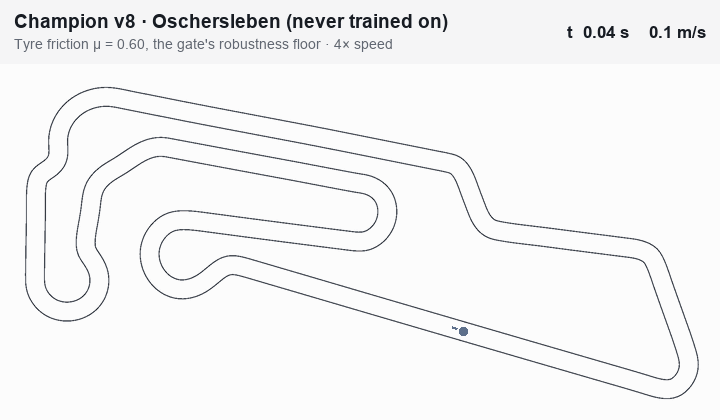
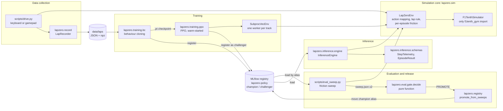

# LapZero

**An autonomous racing policy for the F1TENTH simulator. It learns from human laps, improves with reinforcement learning, and is only released after passing a tyre-grip robustness gate and a version-guarded model registry.**

[](pyproject.toml)
[](docs/contracts/state_space.md)
[](pyproject.toml)
[](pyproject.toml)
[](#verification)
[](#verification)

LapZero trains a driving policy in [F1TENTH Gym](https://github.com/f1tenth/f1tenth_gym). It starts with behaviour cloning on a handful of human laps, then fine-tunes with PPO across several tracks and randomized tyre friction. The goal is a policy that is fast at nominal grip and still finishes laps when grip drops. The engineering effort goes into proving that. A binding state-space contract defines what counts as a lap. A friction sweep measures every candidate the same way. A release gate decides promotion from two sweep reports. MLflow aliases only move when the evaluated versions are still the ones the registry points at.

> **Headline result.** Champion **v8** completed **120 / 120** one-lap episodes on **Oschersleben**, a track it never trained on, across tyre friction μ = 0.50 to 1.05. At nominal grip it was **1.71 % faster** than the champion it replaced (45.98 s vs. 46.78 s). The release gate approved it, and the promotion recorded both sweep IDs on the model version. [Details and caveats ↓](#results-champion-v8-on-oschersleben)

[Results](#results-champion-v8-on-oschersleben) · [Architecture](#architecture) · [Lap contract](#state-space-contract-v110-and-lap-validity) · [Domain randomization](#domain-randomization-and-robustness) · [Registry and release gate](#model-registry-and-release-gate) · [Inference](#inference-engine) · [Quickstart](#quickstart) · [Limitations](#limitations-and-reproducibility)

> [!NOTE]
> The test and coverage badges are static. They record a local run on 2026-10-13 at commit `f230571` because the repository has no CI workflow yet. See [Verification](#verification) for the exact commands and results.

---

## Demo

<!--
TODO(demo): add a verified Champion v8 domain-randomization lap, then replace the NOTE below with:
<p align="center">
  
</p>
-->

> [!NOTE]
> **Demo recording pending.** No lap GIF or video is committed yet. Every number in this README comes from stored evaluation reports and a re-run of the gate, not from a recording.

<details>
<summary>Recording spec for the demo GIF</summary>

- **File:** `docs/assets/champion-v8-oschersleben-mu060.gif`
- **Content:** the registry `champion` (version 8) driving one full counted lap of Oschersleben at reduced grip, preferably μ = 0.60 (the bottom of the gate's robustness range). Show the start, the whole lap and the completion. Overlay μ, speed and lap time if possible.
- **Visibility:** keep the whole track in frame, or follow the car with the driven line visible, so viewers can read the line, the car's behaviour in corners and the lap completion.
- **Encoding:** 25 to 30 fps (the policy acts at 25 Hz), at most 760 px wide, ideally under about 8 MB. A lap takes about 46 s, so speed it up 2 to 4 times and say so in the caption, or link an MP4 instead.
- **How:** no script renders a model lap yet. There are two options:
  - Build `F1TenthSimulator(map_yaml, seed=0, render=True)` with `LapZeroEnv(..., config=EnvConfig(friction_range=(0.6, 0.6)), centreline=...)`, call `simulator.render()` every step and screen-record the window. F1TENTH draws the world mirrored; see `RENDER_MIRRORED` in [`lapzero/sim/f1tenth.py`](lapzero/sim/f1tenth.py).
  - Animate a trace that `scripts/eval_sweep.py` already writes (`mu_<mu>/seed_<n>.csv`, columns `t,x,y,theta,v_long,steer,throttle,steer_rad,v_target,progress,cte_m,collision`) over the track's map image.

</details>

---

## Engineering at a glance

| Concern | What LapZero does | Where |
|---|---|---|
| Lap validity | A start-line pass counts as a lap only after ≥ 90 % of the centreline has been driven, net of reversing | [`lapzero/sim/env.py`](lapzero/sim/env.py) |
| Robustness | Tyre friction μ drawn uniformly per training episode; candidates swept over μ 0.50 to 1.05 | [`env.py`](lapzero/sim/env.py), [`eval/sweep.py`](lapzero/eval/sweep.py) |
| Multi-track training | One subprocess per track, because F1TENTH keeps the LiDAR map in process-global state | [`training/vec_env.py`](lapzero/training/vec_env.py) |
| Release decision | Pure function over two sweep reports: robustness check plus pace check | [`eval/gate.py`](lapzero/eval/gate.py) |
| Governance | Promotion refuses if either alias moved after its sweep; evidence is tagged on the new champion | [`registry.py`](lapzero/registry.py) |
| Reproducibility | Every run logs all contract constants, hyperparameters, seed, track IDs and git commit | [`training/tracking.py`](lapzero/training/tracking.py) |
| Typed I/O | Frozen Pydantic models reject NaN, inf and unknown fields | [`inference/schemas.py`](lapzero/inference/schemas.py), [`io/telemetry.py`](lapzero/io/telemetry.py) |
| Quality bar | 820 tests (24 property-based), 99 % line coverage, `mypy --strict`, ruff | [`tests/`](tests) |

---

## Results: Champion v8 on Oschersleben

Both policies were evaluated with the release gate's sweep on **Oschersleben** (260.7 m, clockwise). The settings were friction μ = 0.50 to 1.05 in 0.05 steps, 10 one-lap episodes per level from jittered start poses, and seeds 0 to 9 at every level. Neither policy trained on Oschersleben.

| Policy | Trained on | Completion, all levels (μ 0.50–1.05) | Completion, gate range (μ 0.60–1.05) | Mean lap at nominal grip (μ 1.05) | Pace vs. baseline | Evidence |
|---|---|---:|---:|---:|---:|---|
| **v8**, current `champion` | PPO, Spielberg + Moscow Raceway, μ ~ U(0.50, 1.05), 1 M steps | **120 / 120** | **100 / 100** | **45.98 s** (45.88 to 46.08) | **−1.71 %** | sweep `01M4TH84XCQYGAD34XR0C5BTDH` |
| v5, previous champion (baseline) | PPO, Spielberg, default friction, 100 k steps | 79 / 120 | 79 / 100 | 46.78 s (46.48 to 47.04) | — | sweep `01M4TGPRVQY5F71QAQKBSR5RKQ` |

The release gate re-run on those two stored sweeps with the current code (a dry run, so the registry is untouched):

```text
Release gate on oschersleben, contract 1.1.0
  champion    lapzero-policy@champion, version 5, sweep 01M4TGPRVQY5F71QAQKBSR5RKQ
  challenger  lapzero-policy@challenger, version 8, sweep 01M4TH84XCQYGAD34XR0C5BTDH
  robustness passed: challenger completed 100/100 episodes (100.0%) with mu in [0.60, 1.05], needs >= 98%
  pace passed: challenger 45.98 s vs champion 46.78 s at nominal grip (mu 1.05) (-1.71%), allowed +2.0%
verdict: PROMOTE
```

In the MLflow registry, model version 8 holds the `champion` alias and carries the tags `gate_result=promote`, `gate_track=oschersleben`, `gate_champion_sweep=01M4TGPRVQY5F71QAQKBSR5RKQ`, `gate_challenger_sweep=01M4TH84XCQYGAD34XR0C5BTDH` and `replaced_champion_version=5`.

<details>
<summary>Per-level results</summary>

| μ | v5 completed | v5 mean lap | v8 completed | v8 mean lap |
|---:|---:|---:|---:|---:|
| 0.50 | 0 / 10 | — | 10 / 10 | 46.37 s |
| 0.55 | 0 / 10 | — | 10 / 10 | 46.26 s |
| 0.60 | 0 / 10 | — | 10 / 10 | 46.20 s |
| 0.65 | 0 / 10 | — | 10 / 10 | 46.14 s |
| 0.70 | 9 / 10 | 47.95 s | 10 / 10 | 46.08 s |
| 0.75 | 10 / 10 | 47.83 s | 10 / 10 | 46.05 s |
| 0.80 | 10 / 10 | 47.47 s | 10 / 10 | 46.04 s |
| 0.85 | 10 / 10 | 47.30 s | 10 / 10 | 46.02 s |
| 0.90 | 10 / 10 | 47.21 s | 10 / 10 | 46.04 s |
| 0.95 | 10 / 10 | 46.98 s | 10 / 10 | 46.04 s |
| 1.00 | 10 / 10 | 46.91 s | 10 / 10 | 46.05 s |
| 1.05 | 10 / 10 | 46.78 s | 10 / 10 | 45.98 s |

Every v5 failure was a crash (41 total). v8 had no crashes. At nominal grip, v8's mean distance from the centreline was 0.117 m and its maximum was 0.633 m.

</details>

**How the numbers are defined**

- **Completed:** the episode ended on a lap that counts under contract v1.1.0 (see [below](#state-space-contract-v110-and-lap-validity)), without a collision, within the 120 s limit, and without stalling.
- **Completion rate:** completed episodes ÷ episodes, pooled over the listed levels.
- **Pace change:** challenger mean lap ÷ champion mean lap − 1 at μ = 1.05. Negative means faster. Means use completed episodes only. Lap times are counted in 0.04 s control steps.
- **Baseline:** the champion the gate compared against, v5. That is a PPO policy fine-tuned for 100 k steps on Spielberg from the behaviour-cloning policy.

### How v8 got there

All four PPO versions use the same evaluation settings on Oschersleben. v6, v7 and v8 were each warm-started from v5's actor and trained for 1 M more steps with seed 0.

| Version | MLflow run | Tracks | Friction randomization | Gate-range completion | Nominal lap |
|---|---|---|---|---:|---:|
| v5 | `ppo_v1` | Spielberg | none | 79 / 100 | 46.78 s |
| v7 | `ppo_control_v1` | Spielberg | none | 0 / 100 † | — |
| v6 | `ppo_dr_v1` | Spielberg | U(0.50, 1.05) | 36 / 100 † | 48.38 s |
| v8 | `ppo_multitrack_v1` | Spielberg + Moscow Raceway | U(0.50, 1.05) | **100 / 100** | **45.98 s** |

† Swept with contract v1.0.0 evaluation code. That version's lap rule counted any start-line pass, so these rates can only stay the same or fall under v1.1.0. v5 scored the same under both versions.

**Interpretation.** Training longer on one track at fixed grip made the policy worse on the unseen track (v7 crashed in every episode). Friction randomization recovered some robustness (v6). Adding a second track as well produced a policy that finished every episode and was also the fastest (v8). These runs suggest that grip variation and track variety both matter. They do not establish it. Each configuration is a single training seed, and robustness swung sharply within v8's own run: its checkpoints at 500 k and 800 k steps completed only 13 / 100 and 33 / 100 on the same sweep. See [Limitations](#limitations-and-reproducibility).

---

## Architecture



Every box above imports its constants from [`lapzero/contract.py`](lapzero/contract.py), the only place contract values are defined.

| Stage | Module | Responsibility | Boundary |
|---|---|---|---|
| Shared | [`lapzero/contract.py`](lapzero/contract.py) | Observation and action layout, bounds, rates, episode rules, `CONTRACT_VERSION` | Single source of contract values, logged to every run |
| Shared | [`lapzero/sim/`](lapzero/sim) | `LapZeroEnv` maps policy actions in [−1, 1] to steering (rad) and target velocity (m/s), builds observations, counts laps and draws friction | `LapZeroEnv` is the only caller of `Simulator.step`. `f1tenth.py` is the only module that imports `f1tenth_gym` and checks the simulator's built-in values against the contract on startup. Unit tests swap in a `FakeSimulator` through the `Simulator` protocol |
| Data | [`lapzero/record/`](lapzero/record), [`lapzero/io/`](lapzero/io) | The human driver emits the same action space as models. The recorder writes validated lap telemetry JSON plus an `.npz` of observations and actions | `lapzero.io` never imports `sim` or `training` |
| Training | [`lapzero/training/`](lapzero/training) | BC on completed human laps, PPO fine-tuning, MLflow params, metrics and model registration | Reads laps and a local `.pt` warm start. Writes to MLflow |
| Evaluation | [`lapzero/eval/`](lapzero/eval) | Deterministic one-lap rollouts, friction sweeps, per-episode CSV traces, the gate decision | The gate reads only `sweep.json` files. It never runs the simulator or touches the registry |
| Release | [`lapzero/registry.py`](lapzero/registry.py) | Moves `champion` to the evaluated challenger and tags the evidence | Only called by `scripts/eval_gate.py --promote` after a PROMOTE verdict |
| Inference | [`lapzero/inference/`](lapzero/inference) | Loads a policy and drives it step by step, streaming typed telemetry | See [Inference engine](#inference-engine) for exactly what it depends on |

Training, evaluation and inference do not share a process or talk to each other directly. They communicate through files (`data/laps/`, `models/*.pt`, `sweep.json`) and the MLflow store under `mlruns/`.

---

## State-space contract v1.1.0 and lap validity

[`docs/contracts/state_space.md`](docs/contracts/state_space.md) is the binding interface between the simulator, the learning code and any consumer of telemetry. [`lapzero/contract.py`](lapzero/contract.py) implements it (`CONTRACT_VERSION = "1.1.0"`), and 87 tests in [`tests/contracts/`](tests/contracts) lock it.

| | Definition |
|---|---|
| Observation | 113 float32 values: 108 LiDAR beams (1080 raw beams, min-pooled in bins of 10, ÷ 30 m), then longitudinal speed, lateral speed and yaw rate (each normalized and clipped to [−1, 1]), then the previous action. World pose is never part of the observation |
| Action | `[steer, throttle]` in [−1, 1]. Steering maps to ±0.4189 rad with a 0.15 rad per step rate limit. Throttle maps to a target velocity of +0.6 / −1.2 m/s per step, clipped to [0, 8] m/s |
| Timing | Policy at 25 Hz, each action repeated over 4 physics steps at 100 Hz |
| Episode | Ends on a collision or after the required laps (1 for evaluation, 3 for training). Truncated at 120 s, or after 3 s below 0.2 m/s |

### What counts as a lap

F1TENTH's own lap counter fires on any pass through a gate at the reset pose, in either direction, so a U-turn across the start line would count as a lap. Contract v1.1.0 closes that gap. The env counts a lap only when **both** of these hold:

1. The simulator reports a start-line pass.
2. The car has driven at least `LAP_MIN_PROGRESS = 0.90` of the centreline since reset or the previous lap, **net of any distance driven backwards**.

Simplified from `LapZeroEnv._update_laps`:

```python
progress = (centreline.project(x, y) - start_arc) / centreline.length % 1.0  # 0 at the start line
lap_progress += (progress - prev_progress + 0.5) % 1.0 - 0.5                 # signed step, short way round
if simulator_lap_count_increased:
    if lap_progress >= LAP_MIN_PROGRESS:
        lap_count += 1
        lap_progress = 0.0
    # otherwise the pass is ignored and the episode continues
```

The rule is a **net-progress** condition, not strict monotonicity. The car may briefly reverse, but every metre driven backwards must be made up before a pass counts. [`tests/contracts/test_lap_completion.py`](tests/contracts/test_lap_completion.py) checks that a full lap counts and ends a one-lap episode, and that none of these count:

- a pass before 90 % of the lap
- a U-turn back through the line
- a spin on the line
- a lap driven backwards

It also checks that a full lap after a spin counts from reset. On real laps the margin is small: v8's measured lap fractions at nominal grip were 0.999 or higher.

### Other safeguards that exist in code

- **Walls are the track boundary.** F1TENTH maps are walled, so leaving the track is a collision, and a collision ends the episode. There is no separate off-track detector. Shortcuts beyond the lap rule are prevented by the map geometry.
- **Reward cannot farm projection jumps.** On hairpins or close parallel sections the centreline projection can jump. `RacingReward` clips progress to ±0.8 m per control step (`SIM_V_MAX × CTRL_DT`). This belongs to the reward, not the contract.
- **Simulator drift is caught at startup.** `verify_baseline` compares F1TENTH's timestep, beam count, field of view, range, steering and speed limits with the contract and raises `ContractViolationError` on any mismatch.
- **No NaN or inf crosses a boundary.** Actions are sanitized (NaN becomes 0, values are clipped), NaN or inf LiDAR ranges become max range, a non-finite reward raises, and every Pydantic model rejects NaN and inf.
- **Versions are checked at every hand-off.** Policy checkpoints store their observation and action sizes and `contract_version`, and loading refuses a different contract major version. The gate refuses to compare sweeps from different contract major versions.

**Scope.** These are tested runtime checks, not formal verification. The contract does not detect teleports, because the simulator only moves the car through physics or `reset()`. It also cannot rule out every way a policy might exploit the simulator. An env built **without** a centreline (human recording, some unit tests) cannot measure progress and counts every simulator lap. Evaluation, sweeps, inference and PPO training always supply one, and `RacingReward` refuses to run without it.

---

## Domain randomization and robustness

**Mechanism.** `EnvConfig.friction_range = (low, high)` makes `LapZeroEnv.reset()` draw μ ~ Uniform(low, high) from the env's seeded RNG, after the start-pose jitter. It applies μ with `F1TenthSimulator.set_friction`, which changes the vehicle parameters without restarting the simulator. There is no curriculum: every episode draws independently. The policy is never told μ. It sees LiDAR, its own velocities, yaw rate and previous action, and has to cope with whatever grip it gets.

| | Training (`scripts/train_ppo.py`) | Gate evaluation (`scripts/eval_sweep.py`) |
|---|---|---|
| Friction | Off by default. v8 used `--friction-range 0.50 1.05`, a fresh draw each episode | Fixed per level through the same code path (`friction_range=(μ, μ)`), μ 0.50 to 1.05 in 0.05 steps |
| Start pose | Jitter of ±0.3 m and ±0.1 rad, on by default | Same jitter, on by default. Seeds 0 to 9 give identical start poses at every level and for every policy |
| Tracks | A fixed set, one worker per track (v8: Spielberg, Moscow Raceway) | A single track, Oschersleben, held out from all training |
| Laps per episode | 3 | 1 |

**Not randomized:** vehicle mass, tyre stiffness and other vehicle parameters, actuation delay, and track geometry beyond the choice of track. [`lapzero/eval/perturb.py`](lapzero/eval/perturb.py) adds Gaussian observation noise for evaluation only (`scripts/eval.py --lidar-noise/--speed-noise/--yaw-rate-noise`). It is a diagnostic and is not part of the gate.

**What the data shows.** v8's mean lap time changes by only 0.39 s (0.85 %) between μ = 0.50 and μ = 1.05, while v5 crashes in every episode below μ = 0.70. That fits a policy that drives within the available grip rather than one tuned to a single friction value. Two facts temper this. First, all policies run under the contract's 8 m/s target-velocity cap, and v8 reaches that cap (its maximum speed at nominal grip is 8.0 m/s), so the cap limits how much grip can matter. Second, recovery from a loss of grip is not measured, so no claim is made about it.

---

## Model registry and release gate

### Experiment tracking

Every BC and PPO run opens an MLflow run (experiments `lapzero-bc` and `lapzero-ppo`). By default the store is the file-based `./mlruns`; `MLFLOW_ALLOW_FILE_STORE` is set automatically. Each run logs:

- **Params:** every contract constant (`contract.*`), every PPO, env and reward config field (`ppo.*`, `env.*`, `reward.*`), `contract_version`, `reward_version`, `seed`, `track_ids`, `n_envs`, `warm_start`, and `git_commit` (suffixed `-dirty` when the tree had uncommitted changes).
- **Metrics:** Stable-Baselines3's training metrics, plus `race/*` episode reward, length, collision, friction μ and lap time, pooled and per track (`race/<track_id>/lap_time`).
- **Model:** the policy checkpoint, logged as an MLflow Model with a custom `lapzero_policy` flavor that records `contract_version`. It is registered as a new version of the single registered model `lapzero-policy` and tagged `algorithm`, `contract_version` and `reward_version`.

### Aliases

| Alias | Who sets it | Rule |
|---|---|---|
| `champion` | First registration, then only `promote_challenger` | Training never replaces a champion. The first version of the model becomes champion so the gate has a baseline |
| `challenger` | Every later training run | Moves to the newest trained version. Removed when it is promoted |

### Release gate

**Robustness-aware promotion rule:** a challenger policy replaces the champion if it achieves **>= 98% completion** across the domain-randomized friction spectrum (**mu in [0.60, 1.05]**) **and** maintains its **nominal-grip lap time within <= 2.0%** of the champion baseline.

How it is measured (`scripts/eval_sweep.py`, decided by `lapzero/eval/gate.py`):

- Both policies are swept on the same track with the same settings: friction mu 0.50 to 1.05 in 0.05 steps, 10 one-lap episodes per level from jittered start poses (seeds 0 to 9, the same at every level).
- Completion is pooled over every episode at mu 0.60 to 1.05: 10 levels, 100 episodes, so at most 2 may fail. The levels below 0.60 are reported but do not count.
- Nominal grip is mu 1.05 (F1TENTH's default 1.0489, rounded). The challenger's mean lap time there may be at most 2.0% above the champion's. A policy with no completed lap at nominal grip fails this check.
- The gate refuses to compare policies whose `contract_version` major numbers differ.

Changing these rules requires approval.

The implementation also refuses to compare sweeps that differ in track, seed, episodes per level, start jitter, start pose or friction levels, or that lack a level at μ 0.60 or 1.05. Gate logic is a pure function (`decide(champion, challenger) -> GateDecision`) with one reason string per check.

### Promotion safeguards

`scripts/eval_gate.py --promote` calls `lapzero.registry.promote_from_sweeps` only after a PROMOTE verdict. Promotion is refused, and the registry left unchanged, if:

- either sweep evaluated a local `.pt` checkpoint rather than a registry version,
- the two sweeps ran on different tracks,
- the `champion` or `challenger` alias **no longer points at the version its sweep evaluated** (for example, a training run registered a new challenger while the sweep was running),
- either alias is missing, or a sweep or track ID is malformed.

On success the challenger's version is tagged with the gate evidence (`gate_result`, both sweep IDs, `gate_track`, `replaced_champion_version`), the `champion` alias moves to it, and the `challenger` alias is deleted.

**What this does and does not enforce.** The guard is enforced by LapZero's tooling, not by MLflow. Anyone with write access to `mlruns/` can still move an alias through the MLflow API, and `promote_challenger` is a library function that does not run the gate itself. Promotion is three MLflow calls (tag, move alias, delete alias), not a transaction. No CI workflow runs the gate yet; it is run by hand. In the current registry, v8 is the only version with gate tags. v5 became champion before the gate existed.

---

## Inference engine

[`lapzero/inference/engine.py`](lapzero/inference/engine.py) wraps one F1TENTH simulator and one policy. Every control step comes out as a validated `StepTelemetry`. A completed episode comes out as an `EpisodeResult`.

```python
from lapzero.inference.engine import InferenceEngine

with InferenceEngine(
    "champion",  # or "challenger", "models:/lapzero-policy@champion", a run ID, or a .pt path
    "data/tracks/oschersleben/oschersleben.yaml",
    "data/tracks/oschersleben/centreline.csv",
    friction=0.60,
) as engine:
    result = engine.run_episode()  # EpisodeResult: validated, frozen, NaN/inf-free

print(result.status, result.lap_time_s, result.steps)
print(result.frames[-1].model_dump_json())
```

Run from the repo root against the current registry, this prints `completed 46.160000000000004 1154`, followed by the final frame as JSON. Other entry points are `reset()` and `step(action=None)` for step-by-step control (pass an action to override the policy), `stream_episode()`, a generator that yields frames as they are driven, and `predict(obs)`.

**Model sources** (`load_policy_source`): a `.pt` checkpoint, `champion` or `challenger`, `models:/<name>@<alias>`, `runs:/<run_id>/<path>`, or a bare 32-character run ID (resolved to the latest version that run registered).

**Validation in the schemas.** All models are frozen, reject unknown fields, and reject NaN and inf. `StepTelemetry` bounds steering, throttle, steering angle, target velocity, heading and progress to their contract ranges, requires `speed == hypot(v_long, v_lat)` and requires `lap_time <= t`. `EpisodeResult` requires consecutive step numbers, strictly increasing time and non-decreasing lap counts, and no frame after a collision. Its summary fields must match the last frame, its status must agree with its collision flag and lap time, and a completed episode needs at least one counted lap.

**The dependency boundary, stated precisely.** The engine is not a lightweight runtime. It imports `torch`, `gymnasium`, `lapzero.sim` and `lapzero.training`, and it loads `mlflow` and `f1tenth_gym` when it needs them. The clean boundary is [`lapzero/inference/schemas.py`](lapzero/inference/schemas.py), which imports only Pydantic, `lapzero.contract` and `lapzero.io.telemetry`; in a fresh interpreter it pulls in no `torch`, `mlflow`, `gymnasium` or simulator modules. A consumer such as a web API can therefore validate and serve telemetry without installing the ML stack, and that consumer would run the engine in a separate worker. Policy execution itself still needs PyTorch.

---

## Quickstart

**Prerequisites:** Python 3.11 (pinned in [`.python-version`](.python-version)), [uv](https://docs.astral.sh/uv/) (0.9.x; the build backend is pinned to `uv_build>=0.9.30,<0.10`), and git, because `f1tenth-gym` is installed from a pinned git commit. Developed and verified on macOS. Linux has not been tested here.

### 1. Install

```bash
git clone https://github.com/ssaillesh/lapzero.git
cd lapzero
scripts/setup_dev.sh   # uv sync --all-groups, then checks a fresh interpreter can import lapzero
```

### 2. Check the code

```bash
uv run pytest tests/unit                                   # 709 unit tests, no simulator
uv run pytest tests/contracts                              # 87 contract tests
uv run pytest -m integration                               # 24 tests on the real F1TENTH simulator
uv run pytest                                              # everything (820 tests)
uv run pytest -m "not integration" --cov=lapzero --cov-report=term-missing
uv run mypy --strict lapzero scripts
uv run ruff check . && uv run ruff format --check .
```

Integration tests build their own small maps and temporary MLflow stores, so they need no track data and leave `mlruns/` alone.

### 3. Get the tracks

Tracks come from [f1tenth/f1tenth_racetracks](https://github.com/f1tenth/f1tenth_racetracks) and are **GPL-3.0**, so they live under the gitignored `data/` folder. Each track needs `data/tracks/<id>/<id>.yaml`, the image it names, and `centreline.csv`:

```bash
fetch_track() {  # fetch_track <upstream name> <track_id>
  local base="https://raw.githubusercontent.com/f1tenth/f1tenth_racetracks/main/$1" dir="data/tracks/$2"
  mkdir -p "$dir"
  curl -fsSL "$base/$1_map.png" -o "$dir/$2.png"
  curl -fsSL "$base/$1_centerline.csv" -o "$dir/centreline.csv"
  curl -fsSL "$base/$1_map.yaml" | sed "s/^image:.*/image: $2.png/" > "$dir/$2.yaml"
}
fetch_track Spielberg spielberg
fetch_track MoscowRaceway moscowraceway
fetch_track Oschersleben oschersleben
```

### 4. Train, evaluate, gate, drive

The commands below reproduce the configuration MLflow logged for v5 and v8. They have not been re-run from scratch for this README.

```bash
# Record human laps (arrows steer, Up/Down throttle and brake, R restarts, Esc quits)
uv run python scripts/drive.py --map data/tracks/spielberg/spielberg.yaml \
    --start 0 0 -2.879 --track-id spielberg --direction cw --length-m 343.3

# Behaviour cloning on completed human laps; the first registered version becomes champion
uv run python scripts/train_bc.py --track spielberg --output models/bc_v1.pt

# PPO stage 1 (v5's configuration): 100 k steps on Spielberg from the BC weights
uv run python scripts/train_ppo.py --tracks spielberg --total-timesteps 100000 \
    --bc-weights models/bc_v1.pt --output models/ppo_v1.pt

# PPO stage 2 (v8's configuration): two tracks, friction randomization, 1 M steps
uv run python scripts/train_ppo.py --tracks spielberg moscowraceway \
    --bc-weights models/ppo_v1.pt --friction-range 0.50 1.05 \
    --checkpoint-interval 100000 --output models/ppo_multitrack_v1.pt

# Sweep champion and challenger with identical settings (defaults match the gate)
uv run python scripts/eval_sweep.py --map data/tracks/oschersleben/oschersleben.yaml \
    --centreline data/tracks/oschersleben/centreline.csv --alias champion
uv run python scripts/eval_sweep.py --map data/tracks/oschersleben/oschersleben.yaml \
    --centreline data/tracks/oschersleben/centreline.csv --alias challenger

# Gate: prints the verdict; exits 0 on PROMOTE, 1 on REJECT. Add --promote to move the alias.
uv run python scripts/eval_gate.py \
    --champion-sweep data/eval/friction_sweep/oschersleben/<champion sweep_id> \
    --challenger-sweep data/eval/friction_sweep/oschersleben/<challenger sweep_id>
```

Run every command from the repo root so that all scripts resolve the same `./mlruns` store. Every `PPOConfig` and `RewardConfig` field is also a flag (for example `--learning-rate` or `--collision-penalty`); run any script with `--help` to list them. A refused comparison, such as a contract-major mismatch, raises an exception, which also exits non-zero. LapZero depends on `mlflow-skinny`, which has the client but no UI server.

### Verification

Results from preparing this README on 2026-10-13, at commit `f230571` with a clean working tree:

| Check | Command | Result |
|---|---|---|
| Lint and format | `ruff check .` and `ruff format --check .` | Passed, 98 files formatted |
| Types | `mypy --strict lapzero scripts` | No issues in 42 source files |
| Unit + contract | `pytest -m "not integration" --cov=lapzero` | 796 passed. 99 % line coverage (2,235 statements, 18 missed, all in `sim/f1tenth.py` and `training/vec_env.py`, which only the integration tests exercise) |
| Contract only | `pytest tests/contracts` | 87 passed |
| Integration | `pytest -m integration` | 24 passed in 53 s |
| Gate replay | `scripts/eval_gate.py` on the stored v5 and v8 sweeps, dry run | PROMOTE, −1.71 %, exit 0 |
| Inference example | The snippet in [Inference engine](#inference-engine) | Completed lap, 46.16 s at μ 0.60 |

---

## Repository structure

```text
lapzero/
├── lapzero/                        # importable package
│   ├── contract.py                 # every state-space contract constant (v1.1.0)
│   ├── registry.py                 # version-guarded champion/challenger promotion
│   ├── sim/                        # simulation core
│   │   ├── env.py                  # LapZeroEnv: action mapping, lap rule, friction draw
│   │   ├── f1tenth.py              # F1TENTH backend, baseline check; only f1tenth_gym import
│   │   ├── simulator.py            # Simulator protocol, Pose, SimState
│   │   ├── track.py                # centreline projection and cross-track error
│   │   ├── observation.py          # 113-value observation builder
│   │   ├── lidar.py                # 1080 → 108 min-pooled beams
│   │   └── reward.py               # RacingReward, REWARD_VERSION 1.0.0
│   ├── training/
│   │   ├── bc.py                   # behaviour cloning on completed human laps
│   │   ├── policy.py               # BCPolicy MLP and contract-checked .pt format
│   │   ├── ppo.py                  # PPO warm start, critic warm-up, actor export
│   │   ├── vec_env.py              # one subprocess per track
│   │   ├── callbacks.py            # SB3 → MLflow metrics, per-track lap times, checkpoints
│   │   └── tracking.py             # MLflow runs, params, model registration
│   ├── eval/
│   │   ├── runner.py               # deterministic one-lap episodes with traces
│   │   ├── sweep.py                # friction sweep and the sweep.json schema
│   │   ├── gate.py                 # release gate: pure decide()
│   │   ├── export.py               # summary.json and per-episode CSV traces
│   │   └── perturb.py              # evaluation-only observation noise
│   ├── inference/
│   │   ├── engine.py               # InferenceEngine
│   │   └── schemas.py              # StepTelemetry, EpisodeResult (no sim/training imports)
│   ├── record/                     # human driver, pygame input, lap recorder, session loop, ULIDs
│   └── io/                         # lap telemetry models and .npz reader (no sim/training imports)
├── scripts/                        # thin CLIs over lapzero/
│   ├── drive.py                    # record human laps
│   ├── train_bc.py, train_ppo.py   # training entry points
│   ├── eval.py                     # single-track evaluation with optional noise and friction
│   ├── eval_sweep.py               # friction sweep → sweep.json
│   ├── eval_gate.py                # release gate and optional promotion
│   └── setup_dev.sh                # uv sync and import check
├── tests/
│   ├── contracts/                  # 87 tests that lock docs/contracts/state_space.md
│   ├── unit/                       # 709 tests mirroring lapzero/, run against FakeSimulator
│   └── integration/                # 24 tests on real F1TENTH Gym and temporary MLflow stores
├── docs/contracts/state_space.md   # binding state-space contract
├── pyproject.toml, uv.lock         # dependencies, ruff, mypy, pytest config
└── data/, mlruns/, models/         # local only (gitignored): tracks, laps, sweeps, registry, weights
```

---

## Design decisions

- **One process per track.** F1TENTH Gym stores its LiDAR scan simulator, and with it the map, in class-level state. A second track built in the same process silently replaces the first track's map in every scan. `make_track_vec_env` therefore runs each track in its own `SubprocVecEnv` worker, and an integration test checks that each worker scans its own map. The cost is one process per track; the alternative was LiDAR readings that quietly came from the wrong map.
- **A lap rule owned by the env, not the simulator.** The simulator's gate counts direction-blind passes, so a lap counter built on it can be gamed by a U-turn. Measuring net centreline progress costs one projection per control step, and it makes completion rate (the gate's main metric) mean what it says.
- **Friction randomization plus a held-out track.** Training on one fixed track and grip lets a policy memorize. So far the gate's evidence comes from Oschersleben, a track no candidate trained on, swept across grip levels with matched seeds, so a candidate cannot pass by over-fitting to its own training track.
- **Gate as a pure function over files.** `decide()` takes two validated `SweepReport`s and returns a typed decision with reasons. It is unit-testable without a simulator or registry, can be re-run on stored evidence (as in [Results](#results-champion-v8-on-oschersleben)), and keeps policy (`gate.py`) separate from mechanism (`registry.py`).
- **Version-guarded aliases.** The gate's verdict applies to specific versions. Checking that both aliases still point at the swept versions turns a race between training and promotion into an error instead of a silent promotion of an unevaluated model.
- **A BC warm start that PPO cannot immediately wreck.** The PPO actor copies the BC network's layers and puts tanh on the action mean, so the starting deterministic policy is exactly the BC policy. Before the actor may change, a critic warm-up of 5 rollouts trains the value function with the actor frozen. A small action noise (`log_std_init=-1`), a low learning rate (3e-5), clip 0.1 and a KL cap of 0.02 keep early updates close to the BC policy. The fine-tuned actor is exported back to the BC checkpoint format, so every model loads the same way.
- **Typed telemetry with cross-field invariants.** Range checks alone would accept a frame claiming a completed lap with zero laps counted, or a lap time longer than the episode. The validators reject these at the I/O boundary rather than leaving every consumer to re-check them.
- **A simulator protocol for testability.** Because `LapZeroEnv` depends on a `Simulator` protocol rather than on F1TENTH, 796 tests run in about 20 s with a scripted fake. That includes property-based tests that feed NaN, inf and out-of-range values through the observation and action mappings.

---

## Limitations and reproducibility

- **Simulation only.** All results come from F1TENTH Gym's vehicle model. There is no real-vehicle testing, and friction robustness in simulation does not imply sim-to-real transfer.
- **Narrow evidence.** The gate result covers one held-out track, 12 friction levels and 10 start poses per level, with a deterministic policy. 100 / 100 is consistent with a true completion rate as low as about 96 % (exact binomial 95 % bound). The episodes share seeds and a simulator, so they are not fully independent draws.
- **Single training seed.** Each configuration in [How v8 got there](#how-v8-got-there) was trained once (seed 0). Within v8's own run, held-out robustness ranged from 13 / 100 to 100 / 100 across checkpoints, so v8's result may not be stable across seeds.
- **Speed-capped.** Policies run under the contract's 8 m/s target-velocity cap, which v8 reaches. The pace comparisons are between speed-capped policies.
- **Limited human data.** The BC policy behind v5 and v8 was trained on 5 completed human laps recorded on Spielberg (lap track IDs `spielberg` and `spielberg_wide`; 4 for training, 1 for validation).
- **Provenance.** The v8 training run and both gate sweeps record `git_commit d672439…-dirty`, meaning they ran on uncommitted changes that were committed later. v6 and v7 were swept with contract v1.0.0 evaluation code (marked † above). The gate re-run in this README uses the current code on the stored sweeps.
- **Artifacts are not in git.** Model weights, `mlruns/`, recorded laps, sweeps and the GPL-3.0 tracks are gitignored. Reproducing the exact numbers needs the local registry, or retraining with the commands above, which will not be bit-identical.
- **Hardware.** Training runs on CPU by design (`device="cpu"`, for reproducibility). v8's 1 M steps on 2 tracks took about 16 minutes (977 s at about 1,000 steps per second) on the author's Mac.

---

## Roadmap

Planned in the project instructions and the contract, but **not implemented in this repository yet**:

- FastAPI backend with PostgreSQL for laps, replays and model history, and a React dashboard with ghost-lap replay (contract Section 6)
- GitHub Actions for CI and for running the release gate (`ci.yml`, `release-gate.yml`)
- JSON Schema files under `schemas/` and their contract tests (`test_telemetry_schema.py`, `test_replay_schema.py`)
- `scripts/check_sim_params.py`. Until it exists, `verify_baseline` performs the same check every time the simulator starts
- SAC as a second RL algorithm, and a demo recording (see [Demo](#demo))

## Stack

Python 3.11 · F1TENTH Gym (git `5a301bd`) · Gymnasium 0.29.1 · Stable-Baselines3 2.9.0 · PyTorch 2.14.1 · MLflow (skinny) 3.17.0 · Pydantic 2.14.1 · NumPy 2.4.6. Development tools: pytest, pytest-cov, Hypothesis, mypy, ruff. Versions are those resolved in [`uv.lock`](uv.lock).
